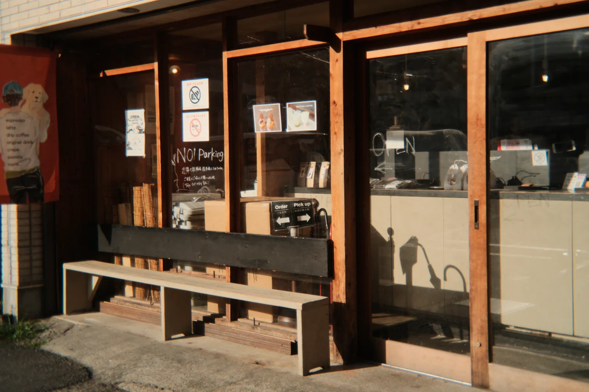
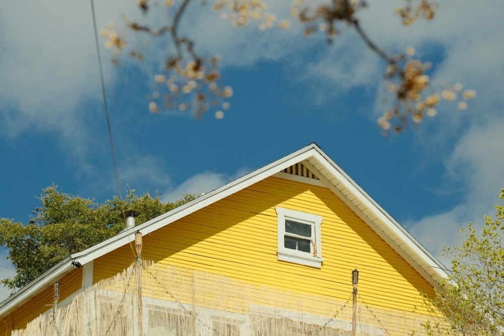

# FUJIFILM DAILY

samedi 7 novembre 2026

Le goût de l’image imparfaite

© Bold Lens Co. — photographie réalisée avec le BL-32. — [Source de l’image](https://boldlens.co/)

## Note de la rédaction

Édition de référence réalisée le 7 novembre 2026, hors automatisation. Pour ce premier numéro, la sélection couvre les publications récentes des 4 et 5 novembre et deux découvertes créatives datées, sans les présenter comme des annonces du jour. Quatre sujets retenus : aucun remplissage artificiel.

## Sommaire

- [BL-32 : une seconde vie pour l’optique du jetable](#bold-lens-bl32)

- [Trois GFX reçoivent une mise à jour de maintenance](#gfx-firmwares-novembre)

- [Astia, une autre idée de la couleur d’automne](#atelier-astia)

- [Un automne délavé avec AgfaChrome RSX II 200 Expired](#atelier-agfachrome)

## Objectifs et découvertes

### 1/4 — BL-32 : une seconde vie pour l’optique du jetable

Confirmé

Présenté par Digital Camera World le 5 novembre, le Bold Lens BL-32 réemploie une optique de jetable dans un corps imprimé en 3D et assemblé à la main à Bangkok ; le fabricant confirme une version Fujifilm X couvrant l’APS-C.[8][9]

Ce 32 mm entièrement manuel dispose d’un diaphragme à six lamelles réglable de f/5,6 à f/22, sans contacts électroniques, pour un prix affiché de 49 dollars hors transport et taxes.[8] Sur tes X-E5 et X-Pro2, l’intérêt serait moins de chercher une netteté clinique que d’explorer une autre façon de photographier la rue : le fabricant montre des images réellement prises avec le BL-32, mais nous n’avons pas testé l’objectif.

Vérifie le réglage « déclencher sans objectif » dans le manuel du boîtier et la disponibilité de la bonne monture avant toute commande ; les lots sont petits et le coût livré en France n’est pas établi ici.[8] À f/5,6 au mieux, ce n’est pas le candidat naturel pour remplacer une focale fixe lumineuse en basse lumière.

## Firmwares et logiciels

### 2/4 — Trois GFX reçoivent une mise à jour de maintenance

Confirmé

Le tableau officiel Fujifilm, contrôlé directement dans le navigateur, indique trois mises à jour datées du 4 novembre 2026 : GFX100 II en version 2.51, GFX100S II en version 1.22 et GFX100RF en version 1.14.[7] Pour chacune, la description se limite à la correction d’un bug mineur : aucune nouvelle fonction ni amélioration d’autofocus ne peut en être déduite.[7]

C’est une information de maintenance pour les utilisateurs GFX, pas une nouveauté concernant tes X-E5 et X-Pro2. Avant d’installer, ouvre la page officielle correspondant exactement à ton boîtier, vérifie la version et suis la procédure Fujifilm : nous ne qualifions pas ces mises à jour d’indispensables et ne téléchargeons aucun firmware à ta place.

## L’atelier Fuji

### 3/4 — Astia, une autre idée de la couleur d’automne

Création — contenu de fond

© Ritchie Roesch / Fuji X Weekly — Yellow House, Bisbee · X-T5, Astia Azure. — [Source de l’image](https://fujixweekly.com/2026/11/02/5-must-try-astia-recipes/)

Dans sa sélection du 2 novembre, Ritchie Roesch rassemble cinq recettes fondées sur Astia et met notamment en avant CineStill 400D v2 pour la lumière dorée et les feuillages d’automne.[5] La sélection donne aussi une place à Astia Azure, décrite comme lumineuse, légèrement chaude et intéressante aux heures dorées ou bleues.[5]

L’article inclut le X-E5 dans les boîtiers compatibles avec ces recettes, mais pas le X-Pro2 : ne transpose pas automatiquement des réglages prévus pour les générations IV et V vers ton X-Trans III.[5] Proposition d’atelier, et non résultat de test : photographie un même sujet en Astia standard puis avec une seule recette, en conservant cadrage et lumière, pour juger les écarts sans multiplier les paramètres.

### 4/4 — Un automne délavé avec AgfaChrome RSX II 200 Expired

Création — contenu de fond

© Ritchie Roesch / Fuji X Weekly — Time for Meadow Gold, Tulsa · X-E5, AgfaChrome RSX II 200 Expired. — [Source de l’image](https://fujixweekly.com/2026/10/27/agfachrome-rsx-ii-200-expired-a-film-simulation-recipe-for-5th-gen-fujifilm-cameras/)

Publié le 27 octobre sur Fuji X Weekly, ce travail de Thomas Schwab, avec une contribution de Ritchie Roesch, cherche un rendu granuleux, désaturé et polyvalent, notamment pour les mois pluvieux.[10] Son nom évoque des exemples de diapositives périmées : l’auteur précise qu’il ne s’agit pas du rendu normal de l’AgfaChrome RSX II 200.[10]

La recette repose sur Eterna Bleach Bypass, avec notamment un grain fort et petit, Color Chrome FX Blue fort et une balance des blancs Auto Ambiance décalée de +3 rouge et −5 bleu ; les réglages complets restent à consulter dans la source.[10] Le X-E5 figure dans la liste de compatibilité, mais pas le X-Pro2, auquel cette recette ne doit donc pas être présentée comme directement compatible.[10]

Pour un essai personnel, pars avec une seule focale et cherche vitrines, façades et lumière couverte : c’est une proposition créative de la rédaction, pas une promesse de résultat ni une nouvelle annonce matérielle.

## Sources

[1] https://www.fujifilm-x.com/global/support/download/firmware/cameras/gfx100-ii
[2] https://www.fujifilm-x.com/global/support/download/firmware/cameras/gfx100s-ii
[3] https://www.fujifilm-x.com/global/support/download/firmware/cameras/gfx100rf
[5] https://fujixweekly.com/2026/11/02/5-must-try-astia-recipes
[7] https://www.fujifilm-x.com/global/support/download/firmware/cameras
[8] https://boldlens.co
[9] https://www.digitalcameraworld.com/cameras/lenses/made-from-a-smashed-disposable-camera-this-cheap-mirrorless-lens-still-has-an-adjustable-aperture-and-comes-in-multiple-mounts
[10] https://fujixweekly.com/2026/10/27/agfachrome-rsx-ii-200-expired-a-film-simulation-recipe-for-5th-gen-fujifilm-cameras

ceci a été le brief de samedi
