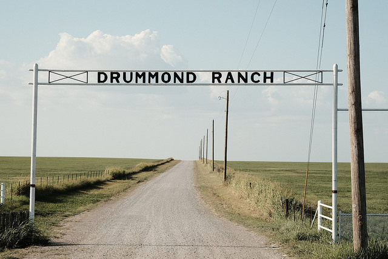
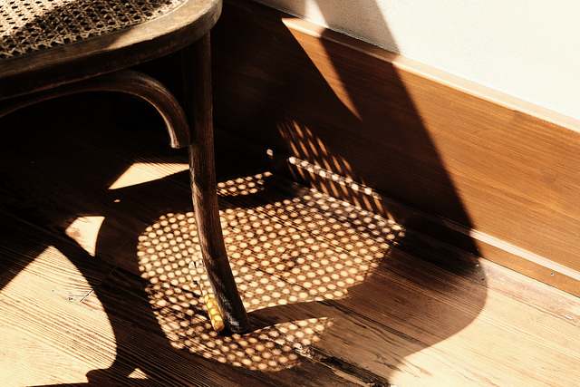

# FUJIFILM DAILY

dimanche 8 novembre 2026

Le dimanche des couleurs et du geste juste

© Ritchie Roesch / Fuji X Weekly — Drummond Ranch · X-Pro2, Kodachrome II. — [Source de l’image](https://fujixweekly.com/2018/08/19/my-fujifilm-x-pro2-kodachrome-ii-film-simulation-recipe/)

## Note de la rédaction

Veille arrêtée le dimanche 8 novembre 2026 à 18 h, heure de Paris, après l’édition du 7 novembre. La sélection du jour privilégie deux ateliers non traités hier, plutôt que de recycler des annonces : une recette de 2018 pour le X-Pro2 et un conseil de workflow publié le 23 octobre. Ce sont des contenus de fond, pas des nouveautés matérielles.

## Sommaire

- [X-Pro2 : retrouver le plaisir de la couleur avec Kodachrome II](#xpro2-kodachrome-ii)

- [JPEG de rue : choisir quand la clarté mérite une pause](#clarte-zero-rue)

## L’atelier Fuji

### 1/2 — X-Pro2 : retrouver le plaisir de la couleur avec Kodachrome II

Création — contenu de fond

© Ritchie Roesch / Fuji X Weekly — Chair Shadow · X-Pro2, Kodachrome II. — [Source de l’image](https://fujixweekly.com/2018/08/19/my-fujifilm-x-pro2-kodachrome-ii-film-simulation-recipe/)

Retour assumé sur une recette publiée par Ritchie Roesch le 19 août 2018 : Kodachrome II s’appuie sur Classic Chrome et s’accompagne de vrais JPEG réalisés au X-Pro2, notamment à Pawhuska avec un 60 mm.[16] C’est donc une piste directement documentée pour ton X-Trans III, et non la transposition incertaine d’une recette récente destinée au X-E5.

Les principaux réglages sont DR200, hautes lumières +1, ombres +2, couleur −1 et balance des blancs automatique décalée de +3 rouge et −4 bleu ; l’auteur utilise un grain faible et suggère généralement une correction d’exposition de +1/3 à +2/3 IL, à adapter à la scène.[16] Il précise lui-même que le résultat évoque davantage Kodachrome-X que strictement Kodachrome II : un parti pris esthétique, pas une reproduction chimique garantie.[16]

Notre exercice : chercher trois détails ordinaires — une ombre de chaise, une enseigne, un bouquet sur une table — et les faire tenir dans une petite série cohérente, sans changer de recette à chaque image. Les exemples donnent envie de regarder les rapports entre couleurs et surfaces plutôt que de courir après un nouveau boîtier ; les réglages complets et les photographies originales sont dans la source.[16]

### 2/2 — JPEG de rue : choisir quand la clarté mérite une pause

Création — contenu de fond

Dans un tutoriel publié le 23 octobre, Ritchie Roesch rappelle qu’un réglage de clarté différent de zéro entraîne une courte pause d’enregistrement ; il explique comment trouver des recettes qui évitent ce compromis dans l’application Fuji X Weekly.[15] La catégorie « Clarity Off » est accessible par le filtre aux abonnés Patron, ou depuis le bas d’une recette correspondante, comme KinaColor 26, pour les autres lecteurs.[15]

L’auteur propose aussi de mettre simplement la clarté à zéro et juge l’écart assez discret pour certains réglages compris entre −2 et +2 ; ce jugement lui appartient et ne remplace pas une comparaison sur tes images.[15] Il rapporte également une méthode RAW+JPEG : photographier avec la clarté à zéro, puis ajouter ce traitement lors d’une conversion RAW ultérieure dans le boîtier ou avec X RAW Studio.[15]

Pour ta prochaine sortie au X-E5, notre proposition est de comparer une même recette avec et sans clarté sur une courte séquence de rue, puis de décider si le rendu vaut l’attente dans ta pratique. Ce conseil concerne les recettes et appareils disposant du réglage décrit ; il ne constitue ni une mise à jour du X-Pro2 ni la promesse d’une compatibilité universelle, et nous n’avons pas chronométré les boîtiers.

## Sources

[15] https://fujixweekly.com/2026/10/23/how-to-find-fujifilm-recipes-without-clarity
[16] https://fujixweekly.com/2018/08/19/my-fujifilm-x-pro2-kodachrome-ii-film-simulation-recipe

ceci a été le brief de dimanche
